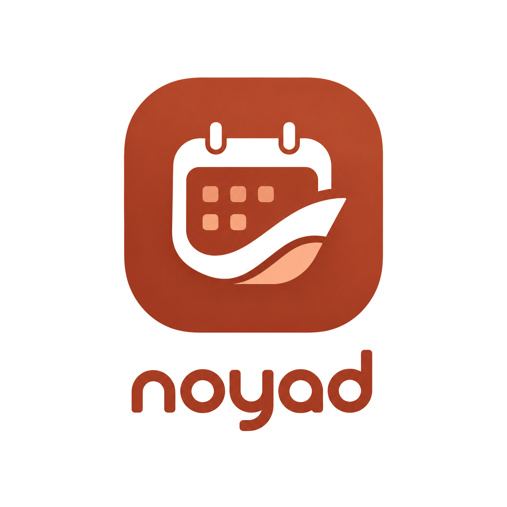

# نویاد (Noyad)

<p align="center">
  
</p>

<p align="center">
  <strong>دستیار هوشمند برنامه‌ریزی روزانه، مدیریت کارها و تقویم شمسی جلالی</strong><br />
  <em>The Intelligent Persian Solar Hijri (Jalali) Calendar & AI-Powered Daily Planner</em>
</p>

<p align="center">
  <a href="#ویژگی‌های-کلیدی--key-features"></a>
  <a href="#فناوری‌ها--tech-stack"></a>
  <a href="#فناوری‌ها--tech-stack"></a>
  <a href="#فناوری‌ها--tech-stack"></a>
  <a href="#معماری-داده--local-first-database"></a>
  <a href="#معماری-داده--local-first-database"></a>
  <a href="#دستیار-هوشمند--ai-assistant"></a>
  <a href="./LICENSE"></a>
</p>

---

## فهرست مطالب (Table of Contents)

- [معرفی کلی (Overview)](#معرفی-کلی-overview)
- [ویژگی‌های کلیدی (Key Features)](#ویژگیهای-کلیدی-key-features)
  - [گاه‌شمار و تقویم خورشیدی (Jalali Calendar)](#1-گاهشمار-و-تقویم-خورشیدی-jalali-calendar)
  - [دستیار هوشمند با چرخش کلید (AI Assistant & Key Rotation)](#2-دستیار-هوشمند-با-چرخش-کلید-ai-assistant--key-rotation)
  - [برنامه‌ریز روزانه و مدیریت وظایف (Daily Planner & Tasks)](#3-برنامه‌ریز-روزانه-و-مدیریت-وظایف-daily-planner--tasks)
  - [یادداشت‌ها و ایده‌برداری (Notes & Ideas)](#4-یادداشت‌ها-و-ایده‌برداری-notes--ideas)
  - [معماری محلی و حریم خصوصی (Local-First & Privacy)](#5-معماری-محلی-و-حریم-خصوصی-local-first--privacy)
  - [طراحی، گلس‌مورفیسم و فونت وزیرمتن (Design System & RTL)](#6-طراحی-گلس‌مورفیسم-و-فونت-وزیرمتن-design-system--rtl)
- [معماری نرم‌افزار و لایه‌بندی (Architecture & Patterns)](#معماری-نرم‌افزار-و-لایه‌بندی-architecture--patterns)
  - [تفکیک چهار لایه مدل داده (4-Tier Model Distinction)](#تفکیک-چهار-لایه-مدل-داده-4-tier-model-distinction)
  - [جریان وابستگی‌ها (Dependency Flow)](#جریان-وابستگیها-dependency-flow)
  - [سیاست تایید اقدامات مخرب (Confirmation Policy)](#سیاست-تایید-اقدامات-مخرب-confirmation-policy)
- [فناوری‌های به‌کاررفته (Tech Stack)](#فناوریهای-بهکاررفته-tech-stack)
- [ساختار پوشه‌ها و فایل‌ها (Project Structure)](#ساختار-پوشهها-و-فایلها-project-structure)
- [راهنمای نصب و راه‌اندازی (Getting Started)](#راهنمای-نصب-و-راهاندازی-getting-started)
  - [پیش‌نیازها](#پیشنیازها)
  - [مراحل نصب](#مراحل-نصب)
  - [تنظیم کلیدهای هوش مصنوعی Groq](#تنظیم-کلیدهای-هوش-مصنوعی-groq)
  - [اجرای برنامه](#اجرای-برنامه)
- [دستورات توسعه (Available Scripts)](#دستورات-توسعه-available-scripts)
- [قوانین توسعه و استانداردهای کدنویسی (Conventions)](#قوانین-توسعه-و-استانداردهای-کدنویسی-conventions)
- [مجوز (License)](#مجوز-license)

---

## معرفی کلی (Overview)

**نویاد (Noyad)** یک نرم‌افزار مدیریت زمان، تقویم شمسی جلالی و دستیار برنامه‌ریزی مبتنی بر هوش مصنوعی است که با اولویت کامل زبان فارسی (Persian-First) و با تمرکز بر حفظ حریم خصوصی کاربران (Local-First) توسعه یافته است.

برخلاف برنامه‌های متداول که نیازمند اتصال مداوم به سرورهای خارجی و ذخیره‌سازی ابری اطلاعات شخصی هستند، نویاد تمامی تسک‌ها، یادداشت‌ها و رویدادهای شما را به صورت **رمزگذاری‌شده و محلی بر روی دستگاه خودتان** نگهداری می‌کند. اتصال به هوش مصنوعی به صورت مستقیم و بدون واسطه از طریق API اختصاصی کاربر با سرویس پرسرعت Groq انجام شده و امکاناتی نظیر استخراج وظایف از روی صحبت محاوره‌ای فارسی، برنامه‌ریزی زمان‌بندی‌شده و پاسخ‌گویی به سوالات روزانه را فراهم می‌سازد.

---

## ویژگی‌های کلیدی (Key Features)

### 1. گاه‌شمار و تقویم خورشیدی (Jalali Calendar)
- **شبکه کامل ماهانه جلالی**: مشاهده روزهای ماه شمسی به همراه نشانگر روز جاری، روزهای دارای کار یا یادداشت، و نام ماه‌های ایرانی (فروردین تا اسفند).
- **نوار روزهای پویا (Days Strip)**: مرور روزهای هفته به صورت افقی در صفحه اصلی برنامه‌ریز برای دسترسی سریع به برنامه‌های هر روز.
- **محاسبات دقیق تقویم**: استفاده از کتابخانه‌های قدرتمند `date-fns-jalali` برای تبدیل‌ها و محاسبات دقیق کبیسه‌ها و روزهای ماه.
- **اعداد فارسی و فرمت‌بندی بومی**: نمایش کامل تاریخ‌ها و ساعات با ارقام فارسی (`۱۴۰۵/۰۱/۰۱`).
- **یکپارچگی پایگاه داده با استاندارد UTC**: تمام زمان‌ها در پایگاه داده به شکل رشته‌های استاندارد UTC ISO 8601 نگهداری می‌شوند و تبدیل شمسی منحصراً در لایه نمایش (Presentation Boundary) صورت می‌پذیرد.

### 2. دستیار هوشمند با چرخش کلید (AI Assistant & Key Rotation)
- **فهم زبان طبیعی فارسی**: امکان ارسال درخواست‌های محاوره‌ای مانند *«فردا ساعت ۵ بعد از ظهر جلسه با تیم فنی رو ثبت کن و اولویتش رو بذار بالا»*.
- **شناسایی خودکار اقدامات (Tool Calling & Actions)**: دستیار به صورت هوشمند ایجاد تسک، ویرایش، تکمیل و جستجوی یادداشت‌ها را تشخیص داده و اجرا می‌کند.
- **مدیریت چندکلید و جابه‌جایی خودکار (Key Rotation & Failover)**: امکان تعریف چند کلید API رایگان گرواک در بخش تنظیمات؛ در صورت مواجهه با محدودیت نرخ (Rate-Limit 429) یا خطای اعتبارسنجی، سیستم به صورت کاملاً خودکار به کلید بعدی سوییچ می‌کند.
- **حالت آفلاین و کاوشگر محلی**: پشتیبانی از قوانین Heuristic محلی برای تجزیه دستورات پایه‌ای هنگام عدم دسترسی به اینترنت یا نبود کلید API.
- **پشتیبانی از مدل‌های پیشرفته**: سازگاری با مدل‌های سریع و مدرن نظیر LLaMA 3.3 70B و GPT-OSS 20B از طریق بستر پرسرعت Groq Cloud.

### 3. برنامه‌ریز روزانه و مدیریت وظایف (Daily Planner & Tasks)
- **داشبورد روزانه (Today Planner)**: دسته‌بندی کارهای امروز، نمایش درصد پیشرفت و کارهای معوقه (Overdue).
- **فهرست جامع کارها (Tasks View)**: فیلتر کردن وظایف بر اساس وضعیت (`انجام‌نشده`, `در حال انجام`, `انجام‌شده`, `لغو شده`) و اولویت (`پایین`, `متوسط`, `بالا`, `فوری`).
- **فرم ویرایش پیشرفته**: امکان تعیین موعد تحویل (Due Date)، ساعت مشخص، اولویت، توضیحات تکمیلی و برچسب‌ها.
- **انیمیشن‌های واکنش‌گرا و چک‌باکس نرم**: تیک زدن و جابه‌جایی وضعیت‌ها با فیدبک بصری روان.

### 4. یادداشت‌ها و ایده‌برداری (Notes & Ideas)
- **ثبت سریع یادداشت‌ها**: ثبت و ذخیره افکار، چک‌لیست‌ها و صورت‌جلسات در دسته‌بندی‌های رنگی.
- **برچسب‌گذاری (Tags)**: جستجو و فیلترسازی سریع یادداشت‌ها بر مبنای هشتگ‌ها و برچسب‌های دلخواه.
- **جستجوی تمام‌متن محلی**: جستجوی سریع در عنوان و بدنه یادداشت‌ها بدون تاخیر شبکه.

### 5. معماری محلی و حریم خصوصی (Local-First & Privacy)
- **پایگاه‌داده توکار SQLite**: با استفاده از موتور سبک و پرسرعت `expo-sqlite` در موبایل (Android/iOS) به همراه حالت پیشرفته WAL (Write-Ahead Logging) و پشتیبانی از کلیدهای خارجی (`foreign_keys = ON`).
- **نگاشت داده با Drizzle ORM**: تایپ‌سیف بودن تمامی کوئری‌ها، روابط پایگاه داده و مهاجرت‌ها (Migrations).
- **پشتیبان وب (Web Fallback)**: در محیط وب، اطلاعات به شکل ساخت‌یافته و ایمن در `localStorage` همگام‌سازی می‌شوند.
- **صفر بودن ردیابی و تله‌متری**: هیچ کدی برای ارسال آمار استفاده یا داده‌های شخصی به سرورهای ثالث وجود ندارد.

### 6. طراحی، گلس‌مورفیسم و فونت وزیرمتن (Design System & RTL)
- **چیدمان بومی راست‌به‌چپ (RTL-First)**: کلیه کامپوننت‌ها با استفاده از خصوصیات منطقی (`marginStart`، `paddingStart` و جهت `rtl`) طراحی شده‌اند.
- **خانواده فونت فارسی وزیرمتن (Vazirmatn)**: در ۸ ضخامت متنوع (Thin, Light, Regular, Medium, SemiBold, Bold, ExtraBold, Black).
- **نوار تب شناور با جلوه شیشه مات (Frosted Glassmorphism)**: نوار ناوبری پایین با استفاده از `BlurView`، بازتاب درخشان (Specular Shine) و انیمیشن‌های پرش فنری (Spring Physics) به همراه فواصل استاندارد برای نمایشگرهای بدون حاشیه و نوارهای پیمایش سه دکمه سامسونگ.
- **پشتیبانی از تم روشن و تاریک (Light & Dark Theme)**: پالت رنگی گرم و ملایم برای روز و تم تاریک غنی برای استراحت چشم در شب.

---

## معماری نرم‌افزار و لایه‌بندی (Architecture & Patterns)

پروژه از اصول معماری تمیز (Clean Architecture) و طراحی دامنه‌محور (Domain-Driven Design) با جهت وابستگی یک‌طرفه بهره می‌برد.

### جریان وابستگی‌ها (Dependency Flow)

```
┌─────────────────────────────────────────────────────────────┐
│                    لایه مسیرها و رابط کاربری                 │
│         (app/ & src/features/*: Screens, Zustand Stores)    │
└──────────────────────────────┬──────────────────────────────┘
                               │
                               ▼
┌─────────────────────────────────────────────────────────────┐
│                      لایه کاربرد و عملیات                    │
│   (src/application/*: Operations, Confirmation, Ports, AI)  │
└──────────────────────────────┬──────────────────────────────┘
                               │
                               ▼
┌─────────────────────────────────────────────────────────────┐
│                      لایه دامنه و اینواریانت                 │
│       (src/domain/*: Entities, Pure Models, Error Contracts) │
└──────────────────────────────┬──────────────────────────────┘
                               ▲
                               │
┌──────────────────────────────┴──────────────────────────────┐
│                    لایه زیرساخت و ارتباطات                   │
│         (src/core/database/*: SQLite, Drizzle ORM)          │
│         (src/core/ai/*: Groq Client, Failover Engine)       │
│         (src/core/calendar/*: Jalali Engine, Date Math)     │
└─────────────────────────────────────────────────────────────┘
```

### تفکیک چهار لایه مدل داده (4-Tier Model Distinction)

برای جلوگیری از نشت منطق دیتابیس یا ساختار هوش مصنوعی به رابط کاربری، چهار بازنمایی مجزا تعریف شده است:

| لایه مدل | مسیر قرارگیری | ویژگی‌ها و کاربرد | نمونه |
| :--- | :--- | :--- | :--- |
| **Domain Model** | `src/domain/models/` | مدل‌های غیرقابل‌تغییر (Immutable)، فیلدهای camelCase، اعتبارسنجی، زمان UTC | `Task` (`dueDate: "2026-10-15T12:00:00Z"`) |
| **Database Record** | `src/domain/types/database.ts` | اسکیمای رابطه‌ای SQLite، فیلدهای snake_case، مقادیر بولین عددی (`0 \| 1`) | `TaskRecord` (`is_all_day: 0`, `due_date`) |
| **AI Payload** | `src/application/ai/contracts.ts` | خروجی خام و غیرقابل‌اعتماد از مدل زبانی (LLM)؛ همراه با امتیاز اطمینان | `UntrustedAiTaskPayload` (`title: "جلسه"`) |
| **UI Presentation Model** | `src/domain/types/presentation.ts` | آماده‌سازی‌شده برای نمایش فارسی با تاریخ جلالی، اعداد فارسی و پالت رنگ | `TaskPresentationModel` (`"۱۴۰۵/۰۷/۲۴"`) |

### سیاست تایید اقدامات مخرب (Confirmation Policy)
کلیه عملیات‌های حذف داده (`delete_task`, `delete_note`) یا جهش‌های غیرقابل‌بازگشت ایجادشده توسط هوش مصنوعی، مشمول سیاست ایمنی تاییدیه می‌شوند:
1. در اولین فراخوانی با ورودی پیش‌فرض، عملیات رد شده و یک توکن درخواست تایید (`ConfirmationRequest`) به رابط کاربری برمی‌گرداند.
2. رابط کاربری پنجره مودال فارسی (`ConfirmationModal`) را با متن صریح هشدار باز می‌کند.
3. تنها پس از تایید آگاهانه کاربر، عملیات با فلگ `confirmed: true` اجرا می‌گردد.

---

## فناوری‌های به‌کاررفته (Tech Stack)

| بخش | فناوری / کتابخانه | نسخه | هدف و توضیحات |
| :--- | :--- | :--- | :--- |
| **هسته فریم‌ورک** | [Expo](https://expo.dev) | `~57.0.30` | پلتفرم مدرن توسعه چندسکویی React Native |
| **موتور رندرینگ** | [React Native](https://reactnative.dev) | `0.86.3` | هسته رندر محلی نیتیو برای Android و iOS |
| **کتابخانه UI** | [React](https://react.dev) | `19.2.3` | معماری مدرن کامپوننت‌محور با React 19 |
| **مسیریابی** | [Expo Router](https://docs.expo.dev/router) | `~57.0.28` | ناوبری فایل‌محور با تایپ کامل (File-based Routing) |
| **پایگاه‌داده** | [Expo SQLite](https://docs.expo.dev/versions/latest/sdk/sqlite/) | `~57.0.4` | پایگاه‌داده محلی SQLite فوق‌سریع بر روی حافظه دستگاه |
| **نگاشت شیء-رابطه‌ای** | [Drizzle ORM](https://orm.drizzle.team) | `^0.45.4` | ORM سبک و ایمن از نظر تایپ برای کوئری‌ها و مایگریشن |
| **مدیریت وضعیت** | [Zustand](https://github.com/pmndrs/zustand) | `^5.0.15` | مدیریت وضعیت سبک، سریع و بدون نیاز به بویلرپلیت |
| **تقویم و تاریخ جلالی** | [date-fns-jalali](https://github.com/m-esm/date-fns-jalali) | `^4.4.0-0` | محاسبات و فرمت‌بندی استاندارد گاه‌شمار هجری خورشیدی |
| **هوش مصنوعی** | [Groq Cloud API](https://console.groq.com) | REST | اجرای فوق‌سریع مدل‌های زبانی متن‌باز با معماری LPU |
| **تایپوگرافی** | [Vazirmatn](https://github.com/rastikerdar/vazirmatn) | `^33.0.3` | خانواده فونت استاندارد و زیبای فارسی اثر صابر راستی‌کردار |
| **افکت‌های بصری** | [Expo Blur](https://docs.expo.dev/versions/latest/sdk/blur/) | `~57.0.3` | ایجاد بلر واقعی و گلس‌مورفیسم برای تب‌بار و هدرها |
| **اعتبارسنجی فرم‌ها** | [Zod](https://zod.dev) & [React Hook Form](https://react-hook-form.com) | `^4.6.7` / `^7.90` | اعتبارسنجی داده‌های ورودی و فرم‌ها با الگوهای سخت‌گیرانه |
| **آیکون‌ها** | [@expo/vector-icons](https://icons.expo.fyi) | `^15.0.2` | آیکون‌های برداری Ionicons |
| **ابزارهای کیفیت کد** | ESLint, Prettier, TypeScript | `^9.22`, `~6.0` | قالب‌بندی خودکار و تحلیل استاتیک کد |

---

## ساختار پوشه‌ها و فایل‌ها (Project Structure)

```text
noyad/
├── app/                              # مسیرها و صفحات ناوبری Expo Router
│   ├── (tabs)/                       # تب‌های اصلی نرم‌افزار
│   │   ├── _layout.tsx               # نوار شناور تب‌ها با بلر گلس‌مورفیسم
│   │   ├── index.tsx                 # صفحه اصلی: برنامه‌ریز امروز (Planner)
│   │   ├── assistant.tsx             # صفحه دستیار هوشمند (AI Chat)
│   │   ├── tasks.tsx                 # صفحه لیست کامل وظایف (Tasks)
│   │   └── notes.tsx                 # صفحه یادداشت‌ها (Notes)
│   ├── _layout.tsx                   # چیدمان ریشه برنامه، فونت‌ها و مقداردهی دیتابیس
│   ├── calendar.tsx                  # مودال نمایش تقویم ماهانه خورشیدی
│   └── settings.tsx                  # مودال تنظیمات، تم و کلیدهای API
├── assets/                           # نمادها، فونت‌ها و تصاویر برنامه
│   ├── fonts/                        # فونت‌های Vazirmatn در اوزان مختلف
│   ├── Noyad-logo.png                # لوگوی نویاد با نشان و نام
│   ├── icon.png                      # آیکون رسمی اپلیکیشن
│   └── splash-icon.png               # تصویر صفحه اسپلش بارگذاری
├── docs/                             # مستندات تکمیلی معماری و دیتابیس
│   ├── architecture-conventions.md   # راهنمای قراردادهای RTL و معماری
│   ├── database-architecture.md      # مستندات زیرساخت دیتابیس محلی
│   └── domain-and-application-contracts.md # مشخصات لایه دامنه و اینواریانت‌ها
├── src/
│   ├── application/                  # لایه منطق کاربرد و قراردادهای بیزینس
│   │   ├── ai/                       # قراردادهای اعتبارسنجی هوش مصنوعی
│   │   ├── operations/               # عملگرهای ایجاد، ویرایش و حذف
│   │   ├── policies/                 # سیاست‌های تایید عملیات‌های مخرب
│   │   └── repositories/             # اینترفیس‌های مخازن داده
│   ├── core/                         # لایه زیرساخت هسته
│   │   ├── ai/                       # کلاینت Groq، استور کلیدها و موتور Failover
│   │   ├── calendar/                 # محاسبات تقویم شمسی جلالی و توابع تاریخ
│   │   ├── database/                 # کلاینت SQLite، اسکیمای Drizzle و Migrations
│   │   └── notifications/            # مدیریت نوتیفیکیشن‌ها و یادآورها
│   ├── domain/                       # لایه دامنه، مدل‌های خالص و خطاها
│   │   ├── errors/                   # مدل خطاهای ساخت‌یافته
│   │   ├── models/                   # انتیتی‌های Task, Note, Conversation, Message
│   │   └── types/                    # تایپ‌های دیتابیس و نمایش
│   ├── features/                     # کامپوننت‌ها و استورهای ویژه هر ویژگی
│   │   ├── calendar/                 # کامپوننت شبکه تقویم و کنترل ماه
│   │   ├── chat/                     # صفحه چت، پیام‌ها و ورودی صوتی/متنی
│   │   ├── notes/                    # کارت‌ها و فرم ثبت یادداشت
│   │   ├── planner/                  # هدر روزانه، خلاصه وضعیت و نوار روزها
│   │   ├── settings/                 # تنظیمات تم، کلیدها و تقویم
│   │   └── tasks/                    # کارت تسک‌ها و مودال افزودن/ویرایش
│   ├── shared/                       # کامپوننت‌ها و هوک‌های عمومی و مشترک
│   │   ├── components/               # دکمه‌ها، کارت‌ها، اینپوت‌ها، مودال‌ها
│   │   ├── hooks/                    # هوک‌های انیمیشن و رفرش
│   │   └── theme/                    # رنگ‌ها، فاصله‌گذاری و استایل‌های مشترک
│   └── types/                        # تعاریف کلی تایپ‌اسکریپت
├── __tests__/                        # تست‌های واحد و یکپارچگی (Jest)
├── app.json                          # پیکربندی پروژه‌ی Expo
├── drizzle.config.ts                 # پیکربندی Drizzle Kit برای استخراج اسکیمای SQL
├── package.json                      # مشخصات پکیج و اسکریپت‌ها
└── tsconfig.json                     # پیکربندی کامپایلر تایپ‌اسکریپت
```

---

## راهنمای نصب و راه‌اندازی (Getting Started)

### پیش‌نیازها
1. **Node.js**: نسخه 18 یا بالاتر (پیشنهاد: LTS 20+)
2. **مدیریت بسته**: `npm` یا `bun`
3. **محیط اجرا**:
   - برای تست سریع: مرورگر وب با دستور `npm run web`
   - برای موبایل فیزیکی: اپلیکیشن **Expo Go** از Google Play یا App Store
   - برای شبیه‌ساز نیتیو: Android Studio (SDK Setup) یا Xcode (macOS)

### مراحل نصب

۱. مخزن پروژه را کلون کنید:
```bash
git clone https://github.com/seyedali-rafazi/noyad.git
cd noyad
```

۲. وابستگی‌ها را نصب فرمایید:
```bash
npm install
```

### تنظیم کلیدهای هوش مصنوعی Groq
برای فعال‌سازی دستیار هوشمند:
1. به کنسول ابری [console.groq.com](https://console.groq.com/keys) مراجعه کرده و یک کلید رایگان ایجاد کنید (معمولاً با `gsk_` آغاز می‌شود).
2. پس از اجرای برنامه، وارد بخش **تنظیمات (آیکون چرخ‌دنده در هدر)** شوید.
3. در کادر «کلید API گرواک»، کلید دریافتی را وارد کرده و دکمه **«ثبت کلید»** را لمس کنید.
4. *نکته اختیاری*: شما می‌توانید چندین کلید ثبت نمایید تا در صورت مصرف سهمیه لحظه‌ای یک کلید، هوش مصنوعی بدون وقفه از کلیدهای پشتیبان استفاده کند.

### اجرای برنامه

- **شروع پروژه با منوی تعاملی Expo**:
  ```bash
  npm start
  ```
- **اجرا روی نسخه وب (مرورگر کامپیوتر)**:
  ```bash
  npm run web
  ```
- **اجرا روی شبیه‌ساز اندروید**:
  ```bash
  npm run android
  ```
- **اجرا روی شبیه‌ساز آی‌او‌اس (مخصوص سیستم‌عامل مک)**:
  ```bash
  npm run ios
  ```
- **پاک‌سازی حافظه کش و اجرای مجدد**:
  ```bash
  npm run clean
  ```

---

## دستورات توسعه (Available Scripts)

در ریشه پروژه اسکریپت‌های زیر در دسترس هستند:

| دستور | توضیح و عملکرد |
| :--- | :--- |
| `npm start` | راه‌اندازی Dev Server اصلی اکسپو |
| `npm run android` | استارت مستقیم روی شبیه‌ساز یا دستگاه متصل اندرویدی |
| `npm run ios` | استارت مستقیم روی سیمولاتور iOS |
| `npm run web` | راه‌اندازی سریع نسخه وب محلی روی پورت ۸۰۸۱ |
| `npm run clean` | پاک‌سازی کامل کش Metro و اجرای مجدد سرور |
| `npm run typecheck` | بررسی و کامپایل دقیق تمام تایپ‌ها با `tsc --noEmit` |
| `npm run lint` | بررسی استانداردهای کدهای پروژه با ESLint 9 |
| `npm run lint:fix` | برطرف کردن خودکار خطاهای قابل اصلاح با ESLint |
| `npm run format` | فرمت‌بندی استاندارد تمامی فایل‌ها بر اساس قوانین Prettier |
| `npm run test` | اجرای تست‌های واحد با Jest |
| `npm run db:generate` | تولید فایل‌های مهاجرت SQL دیتابیس با Drizzle Kit |

---

## قوانین توسعه و استانداردهای کدنویسی (Conventions)

برای حفظ پایداری و یکپارچگی کد در آینده، رعایت اصول زیر الزامی است:

1. **ممنوعیت ذخیره رشته‌های جلالی در پایگاه داده**:
   هیچ زمان و تاریخی نباید به شکل رشته شمسی (مانند `"۱۴۰۵/۰۱/۰۱"`) در SQLite ذخیره شود. تمام فیلدهای زمان در دیتابیس و مدل‌های دامنه باید بر حسب رشته استاندارد UTC ISO 8601 (`YYYY-MM-DDTHH:mm:ss.sssZ`) باشند.
2. **عدم قرارگیری منطق کاری در پوشه `app/`**:
   پوشه `app/` منحصراً مختص روت‌ها و صفحات Expo Router است و باید فاقد کوئری‌های خام دیتابیس یا محاسبات بیزینس باشد؛ منطق‌ها همواره باید در `src/features/` یا `src/application/` پیاده‌سازی شوند.
3. **پشتیبانی نیتیو از RTL**:
   به جای ویژگی‌های فیزیکی مانند `left` یا `right`، اولویت با خصوصیات منطقی مانند `paddingStart`، `paddingEnd`، `marginStart` و `marginEnd` است.
4. **تاییدیه اقدامات خطرناک (Destructive Safety)**:
   هرگونه اقدام حذفی باید از درگاه `defaultConfirmationPolicy` عبور کرده و نیاز به تایید کاربر داشته باشد.
5. **استفاده از `npx expo install`**:
   هنگام اضافه کردن پکیج‌های وابسته به بستر نیتیو، همواره از `npx expo install <package>` استفاده نمایید تا نسخه‌های سازگار با SDK 57 انتخاب گردند.

---

## مجوز (License)

این پروژه تحت مجوز متن‌باز [MIT License](./LICENSE) منتشر شده است. استفاده، ویرایش و توسعه آن با رعایت شرایط این مجوز بلامانع است.

<p align="center">
  ساخته‌شده با ❤️ برای جامعه فارسی‌زبان و کاربران علاقه‌مند به بهره‌وری هوشمند.
</p>
